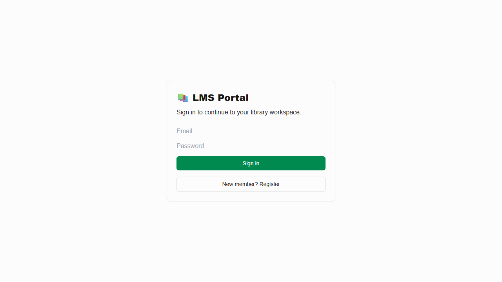
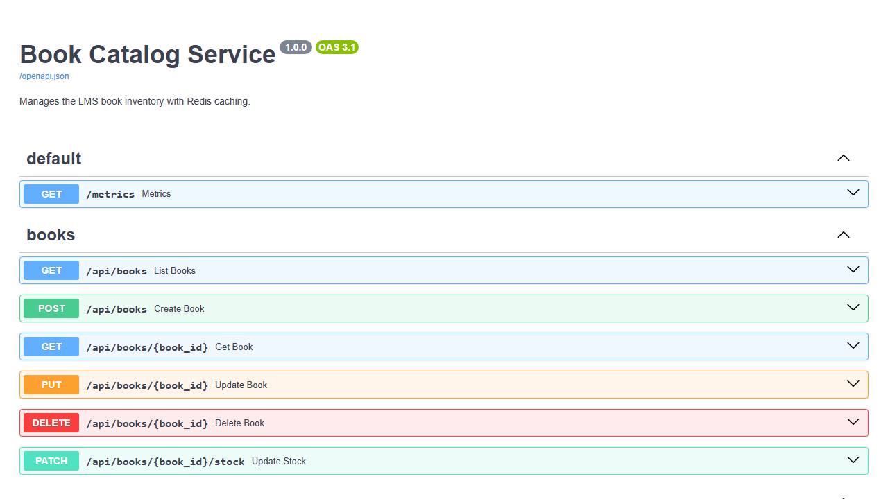
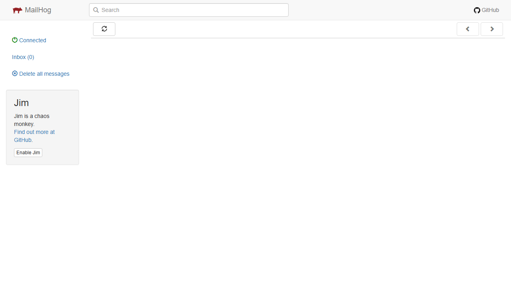
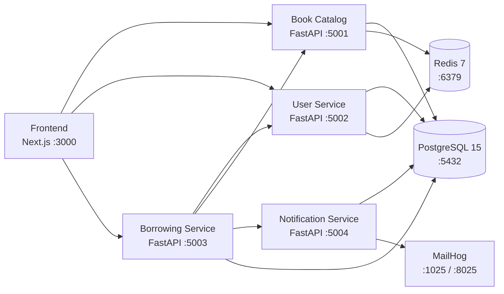
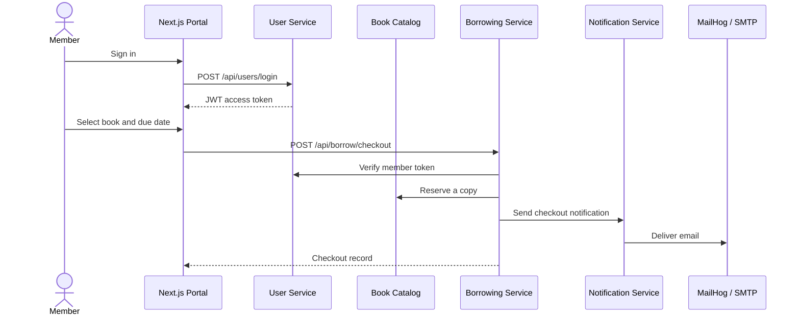

# 📚 Cloud Native Library Management System

<p align="center">
  <strong>A production-oriented, containerized platform for modern library operations.</strong><br />
  Manage books, members, circulation, notifications, observability, and resilience from one unified system.
</p>

<p align="center">
  <a href="#-quick-start"></a>
  <a href="#-architecture"></a>
  <a href="#-observability"></a>
</p>

<p align="center">
  <a href="https://github.com/Nikhil-tech-eng"></a>
  <a href="mailto:nikhil.teckchandani.1010@gmail.com"></a>
</p>

## ✨ Overview

The Cloud Native Library Management System (LMS) is a full-stack application built around independently deployable services. It supports catalogue discovery, authentication, member management, book checkout and returns, transactional notifications, monitoring, and Chaos Mesh experiments.

### Highlights

- 🧩 Four FastAPI microservices with clear service boundaries
- 🖥️ Next.js librarian and member portal
- 🐘 PostgreSQL for durable data and 🔴 Redis for caching/token state
- 🐳 Docker Compose for local development and Kubernetes manifests for Minikube
- 📈 Prometheus metrics and Grafana dashboards
- 🧪 Chaos Mesh experiments for pod failure, network latency, and CPU stress
- 📬 MailHog for local inspection of transactional emails

## 🖼️ Project screenshots

These screenshots were captured from the project running locally with Docker Compose.

<p align="center">
  
  
</p>

<p align="center">
  
</p>

## 🏗️ Architecture



## 📦 Service inventory

| Service | Port | Technology | Responsibility |
|---|---:|---|---|
| `book-catalog` | `5001` | FastAPI, asyncpg, Redis | Book inventory, search, and stock |
| `user-service` | `5002` | FastAPI, asyncpg, PyJWT, bcrypt | Authentication, JWT, and members |
| `borrowing-service` | `5003` | FastAPI, asyncpg, httpx | Checkout, returns, fines, and history |
| `notification-service` | `5004` | FastAPI, asyncpg, aiosmtplib | Transactional notification delivery |
| `frontend` | `3000` | Next.js 14, React, Tailwind CSS | Librarian and member portal |
| PostgreSQL | `5432` | PostgreSQL 15 | Persistent relational data |
| Redis | `6379` | Redis 7 | Cache and token blacklist |
| MailHog | `8025` | MailHog | Local email inbox and SMTP sink |

## 🚀 Quick start

### Prerequisites

- Docker Desktop with the Compose plugin
- Git
- PowerShell, Windows Terminal, or Git Bash
- Optional for Kubernetes: Minikube, kubectl, Helm, and Chaos Mesh

### Run locally with Docker Compose

```powershell
git clone <your-github-repository-url>
Set-Location "Cloud Native Library Management System"
Copy-Item .env.example .env
docker compose up --build -d
docker compose ps
```

| Tool | URL |
|---|---|
| 🖥️ Library portal | [http://localhost:3000](http://localhost:3000) |
| 📚 Book Catalog Swagger | [http://localhost:5001/docs](http://localhost:5001/docs) |
| 👤 User Service Swagger | [http://localhost:5002/docs](http://localhost:5002/docs) |
| 🔄 Borrowing Swagger | [http://localhost:5003/docs](http://localhost:5003/docs) |
| 🔔 Notification Swagger | [http://localhost:5004/docs](http://localhost:5004/docs) |
| 📬 MailHog inbox | [http://localhost:8025](http://localhost:8025) |

Stop the stack with `docker compose down`. To remove local database and cache volumes too, use `docker compose down -v` (this deletes local development data).

## 🔐 Demo accounts

| Role | Email | Password | Capabilities |
|---|---|---|---|
| Librarian | `librarian@library.org` | `admin123` | Inventory, members, circulation, and statistics |
| Member | `alice@library.org` | `user123` | Search, checkout, active loans, and returns |
| Member | `bob@library.org` | `user123` | Search, checkout, active loans, and returns |

> These credentials are for local demonstration only. Change them before any shared or production deployment.

## 🔄 Typical workflow

1. Sign in through the portal.
2. Search the catalogue and select an available book.
3. Check out the book with a future due date.
4. Confirm the loan and reduced stock in the portal.
5. Inspect the checkout email in MailHog.
6. Return the book and verify stock, loan history, and notification updates.



## ☸️ Kubernetes with Minikube

```powershell
minikube start --cpus=4 --memory=8192
minikube addons enable ingress
minikube addons enable metrics-server
& minikube -p minikube docker-env --shell powershell | Invoke-Expression

docker build -t lms/book-catalog:latest ./book-catalog
docker build -t lms/user-service:latest ./user-service
docker build -t lms/borrowing-service:latest ./borrowing-service
docker build -t lms/notification-service:latest ./notification-service
docker build -t lms/frontend:latest ./frontend

kubectl apply -f infra/k8s/
kubectl get pods
kubectl get services
kubectl get ingress
minikube service frontend-svc
```

For Linux or macOS, replace the PowerShell Docker environment command with `eval $(minikube docker-env)`. For the complete operational runbook, see [`steps to run.md`](steps%20to%20run.md).

## 📊 Observability

Every FastAPI service exposes `GET /health` (liveness), `GET /ready` (dependency readiness), and `GET /metrics` (Prometheus metrics).

```powershell
helm repo add prometheus-community https://prometheus-community.github.io/helm-charts
helm repo update
helm install monitoring prometheus-community/kube-prometheus-stack `
  --namespace monitoring --create-namespace `
  -f infra/monitoring/prometheus-values.yaml

kubectl port-forward -n monitoring svc/monitoring-kube-prometheus-prometheus 9090:9090
kubectl port-forward -n monitoring svc/monitoring-grafana 3001:80
```

## 🧪 Chaos engineering

The experiments in [`infra/chaos/`](infra/chaos/) exercise self-healing, timeout handling, and autoscaling:

```powershell
kubectl apply -f infra/chaos/pod-chaos.yaml
kubectl apply -f infra/chaos/network-chaos.yaml
kubectl apply -f infra/chaos/stress-chaos.yaml
kubectl delete -f infra/chaos/
```

Read [`infra/chaos/README.md`](infra/chaos/README.md) before running experiments on a shared cluster.

## 🔌 API summary

| Method | Endpoint | Service | Access |
|---|---|---|---|
| `GET` | `/api/books` | Book Catalog | Public |
| `POST` | `/api/books` | Book Catalog | Librarian |
| `POST` | `/api/users/register` | User Service | Public |
| `POST` | `/api/users/login` | User Service | Public |
| `GET` | `/api/users/me` | User Service | Bearer token |
| `POST` | `/api/borrow/checkout` | Borrowing | Bearer token |
| `POST` | `/api/borrow/return` | Borrowing | Bearer token |
| `GET` | `/api/borrow/active` | Borrowing | Bearer token |
| `GET` | `/api/borrow/stats` | Borrowing | Librarian |
| `POST` | `/api/notifications/notify` | Notifications | Internal |

Each backend also provides interactive Swagger documentation at `/docs`.

## 🛠️ Useful commands

```powershell
docker compose logs -f borrowing-service
docker compose up -d --build borrowing-service
Invoke-WebRequest http://localhost:5001/health
Invoke-WebRequest http://localhost:5002/ready
docker exec -it lms-postgres psql -U lms_user -d lms_db -c "SELECT id, title, available_copies FROM books;"
docker exec -it lms-redis redis-cli KEYS "*"
```

## 📁 Repository layout

```text
book-catalog/          Book catalogue microservice
user-service/          Authentication and member microservice
borrowing-service/     Checkout, returns, and circulation
notification-service/  Transactional email service
frontend/              Next.js web portal
infra/db/              PostgreSQL schema and database notes
infra/k8s/             Kubernetes manifests
infra/chaos/           Chaos Mesh experiments
infra/monitoring/      Prometheus and Grafana configuration
```

## 🤝 Contributing

1. Create a focused branch for your change.
3. Run the affected service locally and verify health/readiness endpoints.
4. Update documentation when adding endpoints, environment variables, or infrastructure.
5. Open a pull request with a concise summary and verification notes.

## 📄 License and contact

This project is released under the [MIT License](LICENSE). See the [`LICENSE`](LICENSE) file for the complete terms.

- **Author:** Nikhil Tech Eng
- **Email:** [📧 Email](mailto:teckchandaninikhil@gmail.com)
- **GitHub:** [🐙 GitHub](https://github.com/Nikhil-tech-eng)

If this project helps you, consider ⭐ starring the repository and sharing feedback through GitHub.
